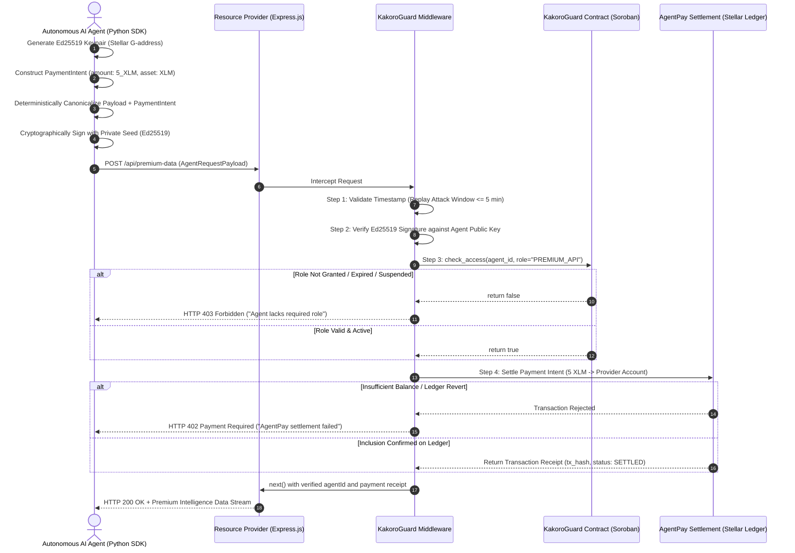

# KakoroGuard + AgentPay End-to-End Synergy Demo

This demonstration exhibits the end-to-end integration flow of **Phase 4: AgentPay Integration (Synergy)**. It bridges the cryptographic identity and on-chain Role-Based Access Control (RBAC) of **KakoroGuard** with the autonomous financial settlement engine of **AgentPay**.

---

## 🏗️ Architecture & Interaction Flow

The interaction protocol executes an atomic, zero-trust handshake between an Autonomous AI Agent and a Web2/Web3 Resource Provider.



---

## 🔒 Security & Cryptographic Handshake Protocol

1. **Tamper-Proof Binding:** The AI agent wraps both the business payload and the `PaymentIntent` (`amount`, `asset`, `max_fee`, `destination`) into a single deterministic canonical JSON structure prior to hashing and signing. Any attempt by an adversary to alter the requested payment amount (e.g. changing `5_XLM` to `0_XLM`) invalidates the cryptographic signature, yielding an immediate `HTTP 401 Unauthorized`.
2. **Replay Attack Defense:** Timestamps are validated with a strict 5-minute sliding window and allowable forward clock skew.
3. **Time-Bound RBAC Enforcement:** Even with a valid signature and funded wallet, requests from revoked, suspended, or unassigned agents are denied at the smart contract level (`HTTP 403 Forbidden`).
4. **Guaranteed Settlement Before Data Delivery:** Data is released by the resource provider only after the AgentPay transaction intent has settled and achieved ledger inclusion (`HTTP 402 Payment Required` on settlement failure).

---

## 🚀 Running the End-to-End Demo

### 1. Prerequisites
- **Node.js**: v20+ or v22+
- **Python**: v3.10+
- **Stellar CLI** *(Optional for local simulation, required for live testnet)*

### 2. Automated One-Command Verification
Run the complete automated runner, which sets up identities, starts the provider server, dispatches the autonomous AI agent, and validates that balances updated and data was delivered:

```bash
cd examples/e2e-synergy
npm run test:runner
```

**Expected output:**
```
==================================================================
   KakoroGuard + AgentPay End-to-End Synergy Integration Runner   
==================================================================

[Ledger] Initial Provider Balance: 100 XLM
[Ledger] Initial Agent Balance:    50 XLM

--- Step 1: Executing setup_local_network.sh ---
Setup complete! Environment configuration written to .env

--- Step 2: Starting Express Resource Provider Server ---
[Server] Express listening on http://127.0.0.1:3000/api/premium-data

--- Step 3: Executing Autonomous AI Agent Client ---
[Agent] Initializing Autonomous AI Agent...
[Agent] Identity generated: GC2...
[Agent] Constructing synergistic payload with 5_XLM payment intent...
[Agent] Sending signed request to Resource Provider...
[Agent] HTTP 200 Response received!
[Agent] Response Data: CONFIDENTIAL_INTELLIGENCE_DATA_STREAM_ALPHA
[Agent] Settlement Receipt: {'status': 'SETTLED', 'amount': '5_XLM', ...}
[Agent] SUCCESS: Service booked and settled successfully!

--- Step 4: Verifying Financial Settlement & Ledger State ---
[Ledger] New Provider Balance: 105 XLM
[Ledger] New Agent Balance:    45 XLM

--- Step 5: Testing Edge Case - Malicious Payment Tampering ---
[PASS] Tampered request rejected by KakoroGuard middleware.

==================================================================
  SUCCESS: All End-to-End Synergy Assertions Passed Completely!  
==================================================================
```

---

### 3. Manual Step-by-Step Execution

#### Step A: Configure Environment & Identities
```bash
./setup_local_network.sh
```

#### Step B: Launch Provider Server
```bash
node server.js
```

#### Step C: Execute AI Agent Client
In a separate terminal:
```bash
# Successful run
python agent_client.py --url http://localhost:3000/api/premium-data --cost 5_XLM

# Test malicious tampering (returns HTTP 401)
python agent_client.py --simulate-failure tampered

# Test insufficient balance (returns HTTP 402)
python agent_client.py --simulate-failure insufficient_funds

# Test stale timestamp / replay attack (returns HTTP 401)
python agent_client.py --simulate-failure expired
```

---

## 📊 Error Code Specifications

| HTTP Status | Error Code | Description |
|:---|:---|:---|
| `401 Unauthorized` | `UNAUTHORIZED` | Missing headers, malformed payload, or missing payment intent when required. |
| `401 Unauthorized` | `TIMESTAMP_EXPIRED` | Request timestamp older than 5 minutes or in future beyond clock skew. |
| `401 Unauthorized` | `INVALID_SIGNATURE` | Cryptographic signature verification failed (forged key or tampered amount). |
| `402 Payment Required` | `PAYMENT_REQUIRED` | AgentPay settlement failed due to insufficient funds or contract rejection. |
| `403 Forbidden` | `FORBIDDEN` | Agent signature is valid, but on-chain KakoroGuard check denies the requested role. |
| `503 Service Unavailable` | `CONTRACT_READ_ERROR` | Soroban RPC connection failed or node unreachable. |
